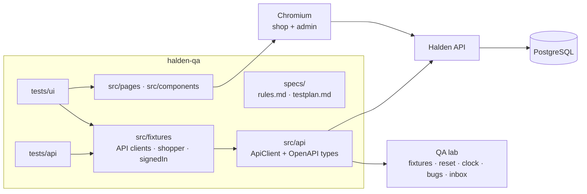

<div align="center">

# halden-qa

**A QA-owned Playwright test suite for [Halden Outfitters](https://github.com/rameshlakmal/halden-outfitters), built
to measure how well AI-assisted test authoring holds up against hand-written tests.**

[](https://github.com/rameshlakmal/halden-qa/actions/workflows/pr.yml)


[](LICENSE)

[Live shop](https://halden-outfitters.vercel.app) ·
[API reference](https://halden-api.vercel.app/api/v1/docs/) ·
[System under test](https://github.com/rameshlakmal/halden-outfitters) ·
[Rules for contributors](CLAUDE.md)

</div>

---

## Contents

- [Why this exists](#why-this-exists)
- [Highlights](#highlights)
- [Architecture](#architecture)
- [Getting started](#getting-started)
- [Running the tests](#running-the-tests)
- [Project structure](#project-structure)
- [Writing a test](#writing-a-test)
- [Guardrails](#guardrails)
- [Test data and isolation](#test-data-and-isolation)
- [Continuous integration](#continuous-integration)
- [Roadmap](#roadmap)
- [Contributing](#contributing)
- [License](#license)

## Why this exists

Halden Outfitters is a working e-commerce system (shop, staff admin and REST API) built as a QA target. It has real
business rules for stock, coupons, payments, returns, refunds and loyalty points, and **18 planted bugs** that can be
switched on one at a time.

That makes it unusually good for one question: **does an AI-assisted workflow (Planner → Generator → Healer agents)
produce a test suite as trustworthy as one written by hand?** Most apps can't answer that, because there is no
ground truth. Here there is: every planted bug maps to one business rule, so we can count which suite notices.

This repository is that suite: a production-style architecture first, with the AI workflow added on top under
strict, enforced rules.

## Highlights

- **API-first test pyramid:** business rules are tested through the API; the UI layer proves a person can complete
  the task. Cross-app journeys stay few.
- **A fresh account per test.** Every test that changes data gets its own shopper from the system's fixtures
  endpoint, so tests are isolated and run in parallel.
- **Typed API client** generated from the live OpenAPI 3.1 spec, built on Playwright's request context so every API
  call shows up in a failing test's trace.
- **Role-based projects:** a spec's file name (`*.guest`, `*.customer`, `*.support`, `*.warehouse`, `*.admin`) picks
  its login. Staff logins are created once per run, not per test.
- **Cross-layer assertions:** a UI test that changes data also checks the saved result through the API.
- **Enforced guardrails:** lint, a Claude Code edit hook and a CI guard stop anyone (person or agent) from removing
  assertions, skipping tests or adding fixed waits.
- **Self-cleaning:** test orders are cancelled when a test ends, so runs against a shared environment don't drain
  stock.

## Architecture



| Layer | Share | Proves | Example |
|---|---|---|---|
| API | ~65% | Business rules: money, stock, states, roles, errors, idempotency | A declined card cancels the order and keeps the cart |
| UI | ~25% | A person can complete the task and sees the right state | Adding to the cart updates the header and the saved cart |
| Journeys | ~5% | Flows that cross the shop, admin and API | Buy, ship in the admin, return, see the refund |
| Checks | ~5% | Contracts, accessibility, visual layout | Every response matches the OpenAPI spec |

### Playwright projects

| Project | Runs | Login | Parallel |
|---|---|---|---|
| `setup` | Resets the QA lab, prepares staff tokens and browser logins | API | — |
| `api` | `tests/api/**` | Bearer tokens | ✅ |
| `ui-guest` · `ui-customer` | `tests/ui/**/*.{guest,customer}.spec.ts` against the shop | none · a fresh shopper per test | ✅ |
| `ui-support` · `ui-warehouse` · `ui-admin` | `tests/ui/**/*.{role}.spec.ts` against the admin | saved per run | ✅ |
| `clock` | Anything tagged `@clock` (shop-wide time and bug switches) | as needed | one worker, last |

## Getting started

### Prerequisites

- Node.js 22.12 or later (24 recommended)
- An admin account on the Halden instance you test (the live site, or a local one from the
  [shop repo](https://github.com/rameshlakmal/halden-outfitters))

### Install

```bash
git clone https://github.com/rameshlakmal/halden-qa.git
cd halden-qa
npm install
npx playwright install chromium
cp .env.example .env
```

### Configure

| Variable | Default | Purpose |
|---|---|---|
| `SHOP_URL` | `https://halden-outfitters.vercel.app` | The shop, for `guest` and `customer` UI tests |
| `ADMIN_URL` | `https://halden-admin.vercel.app` | The staff admin, for staff UI tests |
| `API_URL` | `https://halden-api.vercel.app` | The REST API |
| `HALDEN_ADMIN_EMAIL` | `admin@halden.test` | The admin account |
| `HALDEN_ADMIN_PASSWORD` | — | **Required.** Lives in `.env` locally and in secrets in CI, never in code |

Shoppers, support and warehouse accounts need no configuration: the suite creates them through the API on each run.

## Running the tests

```bash
npm test                    # everything: setup, api, ui-*, then clock
npm run test:smoke          # the @smoke subset
npm run test:api            # the API layer only
npx playwright test --ui    # interactive mode
npm run report              # open the last HTML report
```

| Command | Purpose |
|---|---|
| `npm run lint` | ESLint with the Playwright rules |
| `npm run typecheck` | TypeScript, no emit |
| `npm run guard` | The assertion guard against `main` |
| `npm run api:types` | Regenerate `src/api/schema.d.ts` from the API's OpenAPI spec |

Failing tests keep a trace, a screenshot and a video under `test-results/`; open a trace with
`npx playwright show-trace <path>`.

## Project structure

```text
halden-qa/
├── CLAUDE.md                     rules for writing tests (people and AI agents)
├── .claude/                      Claude Code settings and the edit-guard hook
├── specs/
│   ├── <feature>/rules.md        what correct means, as rule ids (R-CHK-01…)
│   ├── <feature>/testplan.md     cases, each linked to the rules it covers
│   └── testid-requests.md        accessible names we've asked the developers for
├── src/
│   ├── api/                      ApiClient, typed helpers, generated OpenAPI types
│   ├── fixtures/                 every fixture; exports test and expect
│   ├── pages/{shop,admin}/       page objects
│   ├── components/               parts shared by several pages
│   ├── data/                     Faker builders
│   └── support/                  paths and helpers
├── tests/
│   ├── setup/                    the setup project
│   ├── api/<feature>/            API tests
│   └── ui/<feature>/             UI tests, named <name>.<role>.spec.ts
├── scripts/                      assertion guard, API type generation
└── .github/workflows/pr.yml      CI
```

## Writing a test

Read [`CLAUDE.md`](CLAUDE.md) first. The short version, in a real example:

```ts
import type { Schemas } from '../../../src/api/client';
import { wellStockedProduct } from '../../../src/api/endpoints/catalog';
import { expect, test } from '../../../src/fixtures';

test.describe('Adding to the cart', () => {
  test(
    'Verify that adding a product updates the cart button and the saved cart',
    { tag: '@smoke' },
    async ({ api, signedIn, productPage, header }) => {
      const product = await wellStockedProduct(api);
      await productPage.goto(product.slug);

      await productPage.addToCart();

      await header.expectCartCount(1);
      const cart = (await (await signedIn.api.get('/cart')).json()) as Schemas['Cart'];
      expect(cart.lines).toEqual([expect.objectContaining({ productId: product.id, qty: 1 })]);
    },
  );
});
```

- Import `test` and `expect` from `src/fixtures`.
- Specs hold behaviour only: no locators, no `page.*` calls. Those live in page objects.
- Titles describe the business outcome. One behaviour per test.
- Arrange with fixtures and API helpers, act once, assert the outcome, including what was saved.
- Tag tests: `@smoke`, `@rule:<id>`, `@bug:<planted bug key>`, `@clock`.

## Guardrails

The rules that matter most are enforced in three places, so they hold for people and AI agents alike:

| Rule | Lint | Edit hook | CI guard |
|---|:---:|:---:|:---:|
| No removed or loosened assertions | | ✅ | ✅ |
| No `skip`, `fixme`, `only` or `fail` | ✅ | ✅ | ✅ |
| No fixed waits, `force: true` or `networkidle` | ✅ | ✅ | ✅ |
| No locators or raw `page` calls in specs | ✅ | | |
| No positional locators (`nth`, `first`, `last`) | ✅ | | |
| Every test asserts something | ✅ | | |

When a business rule really changes, an assertion may change too: the commit must carry a line
`rule-change: <rule id> <reason>`, and the rule in `specs/<feature>/rules.md` is updated first. The guard accepts
nothing else.

## Test data and isolation

- **Accounts:** every test that changes data uses the `shopper` fixture, a new account created through
  `POST /qa/fixtures/shopper` and shaped per test (cart, store credit, points). No test shares a customer.
- **Products** are chosen at run time from those comfortably in stock; stock is shared, so nothing is hard-coded.
- **Clean start:** the setup project calls `POST /qa/reset` (clock back to real time, every planted bug off, unused
  fixture accounts removed).
- **Clean finish:** the `shopper` fixture cancels its open orders, returning their stock.
- **Shared state** (the shop clock, planted bugs) is only changed by tests tagged `@clock`, which run alone.
- **Logins** are reused: sign-ins are rate-limited, so staff tokens are fetched once per run and the admin token is
  reused while it still works.

## Continuous integration

[`pr.yml`](.github/workflows/pr.yml) runs on every pull request and push to `main`:

1. **Quality:** lint, typecheck and, on pull requests, the assertion guard against the base branch.
2. **Smoke:** checks out the [system under test](https://github.com/rameshlakmal/halden-outfitters), starts
   PostgreSQL, the API, the shop and the admin on the runner, seeds them, and runs the `@smoke` tests against that
   private copy. No shared environment is touched, and no secrets are needed.

The HTML report is uploaded as a build artifact, with traces for failures.

## Roadmap

| Milestone | Status |
|---|---|
| **M1 · Skeleton:** projects, API client, fixtures, page objects, guardrails, CI | ✅ Done |
| **M2 · Rules and test plans** for checkout and returns, written from the business rules | Next |
| **M3 · Agents:** Planner, Generator and Healer adapted to this suite, with tool limits | Planned |
| **M4 · Three tracks:** manual, AI workflow, AI workflow + AI-judged assertions | Planned |
| **M5 · Measure:** planted-bug detection, assertion depth, flake rate, time, maintenance, Healer honesty | Planned |
| **M6 · Grow:** the winning workflow across the rest of the shop; nightly cross-browser runs and the bug proof | Planned |

The planned **bug proof** switches each planted bug on in turn and requires its tagged tests to fail, so the suite
proves it would notice the regression, not just that nothing broke today.

## Contributing

1. Branch from `main`.
2. Check `specs/<feature>/testplan.md`: is the case planned, and which rules does it cover?
3. Write the test following [`CLAUDE.md`](CLAUDE.md); see it fail for the right reason at least once.
4. Run `npm run lint && npm run typecheck && npm run guard && npm test`.
5. Open a pull request. CI must be green.

## License

[MIT](LICENSE)
